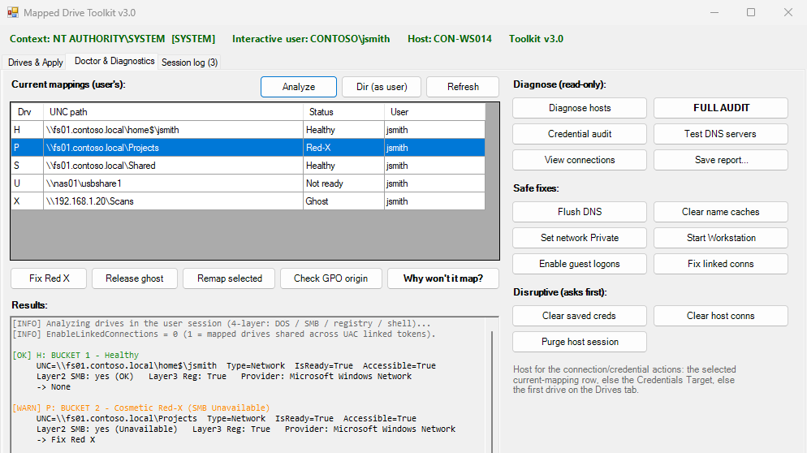

# Mapped Drive Toolkit

A WinForms tool for **Windows PowerShell 5.1** for mapped-drive tickets, built to run as **SYSTEM in a ScreenConnect Backstage session**. One window does both jobs: **what to map** (collect, build and apply a user's drives *into their own session*, so they appear in Explorer straight away) and **why it isn't working** (Red X, ghost drives, Error 85, System error 59, 1219, "Access is denied" and credential mix-ups).

From [ihavenoram.com](https://ihavenoram.com): field notes for ADHD techs running managed services.



## Download

Grab the latest zip from **[Releases](../../releases/latest)**. The SHA-256 checksum is in the release notes and in the `.sha256` file beside the zip:

```powershell
Get-FileHash .\Mapped-Drive-Toolkit.zip -Algorithm SHA256
```

## Run it in Backstage

1. Extract the zip to `C:\temp`, giving `C:\temp\Mapped-Drive-Toolkit\`. Keep the files together.
2. **Lock the folder down before you run anything from it.** By default every signed-in user can modify files under `C:\temp`, and you're about to run these scripts as SYSTEM. In the Backstage command prompt:

   ```bat
   icacls C:\temp\Mapped-Drive-Toolkit /inheritance:r /grant:r *S-1-5-18:(OI)(CI)F *S-1-5-32-544:(OI)(CI)F *S-1-5-32-545:(OI)(CI)RX
   ```

   That leaves SYSTEM and Administrators in full control and everyone else read-only.
3. Double-click **`Launch-MapDrives-Gui.cmd`**. The banner shows the context (SYSTEM or user), the signed-in user and the toolkit version.

It also runs as the user on an ordinary desktop.

## Why "in the user's session" matters

A `net use` drive letter belongs to the logon session that created it. A drive mapped by SYSTEM, by a different elevated admin, or by an RMM's "run as user" works *there* and never appears in the user's Explorer. So the toolkit maps through a one-shot scheduled task as the signed-in user, with the same token Explorer uses, and shows the real `net use` result.

## Drives & Apply: what to map

- **Collect from PC** reads the user's existing mappings and works out which account actually authenticates each one: a `net use /user:` mapping, a saved credential whose target matches the server *exactly*, or plain pass-through. A credential saved under a different name for the same server (`FS01` versus its IP) is flagged, a classic cause of the credential prompt.
- Tick the drives, fix labels, set the credential (`cmdkey`, inline or none) and type the password, then **Apply now**. Nothing is left on disk unless you ask for a `MAPDRIVES.CMD`.
- **Save .json...** keeps a site profile in `profiles\`. See `profiles\example-site.json`. A saved profile includes the typed password, so treat it like one.
- **Export Atera...** bakes the drives into `Inject-MapDrives.Atera.ps1`, which maps them in the user's session when run as SYSTEM. It works from any RMM that runs scripts as SYSTEM, not just Atera.
- **Export User Fixer...** makes a `.cmd` the user runs themselves: it asks for the password, saves it with `cmdkey` and remaps.

## Doctor & Diagnostics: why it isn't working

- **Analyze** classifies every drive from four layers (DOS device, SMB, registry, Explorer's cache) as *Healthy, Red-X, Ghost (Error 85), Not ready* or *Scope*, with targeted fixes: **Fix Red X** (backed up, never unmaps), **Release ghost**, **Remap selected** and **Check GPO origin**.
- **Why won't it map?** runs `Diagnose-MapError.Atera.ps1` on the selected drive: reachability, SMB signing and guest rules, events, and the server's share list plus a `dir` **as the user**. That tells "the server is broken" apart from "that one share is", and suggests a near-miss share name.
- **FULL AUDIT** ranks one top finding across drive health, Credential Manager, Kerberos versus NTLM, domain health, per-share access and SMB events. **Credential audit**, **Diagnose hosts**, **Test DNS servers** and **View connections** are all read-only.
- **Safe fixes** (flush DNS, clear name caches, set the network Private, start Workstation, guest logons, linked connections) and **disruptive** ones that ask first (clear saved credentials, clear connections to a host, purge a host's whole session).
- **Session log** records everything, with Copy and Save.

## Field gotchas it's built around

- **System error 59** happens before the password is checked, so no credential fixes it. Common causes: a NAS USB share renamed underneath you (`usbshare1` versus `usbshare1-1`), Windows 11 24H2 requiring SMB signing from an old NAS, or a SharePoint/WebDAV path.
- **Windows 11 24H2** wants credential user names qualified with the server or IP (`192.168.1.10\nasadmin`, not `nasadmin`).
- **One SMB session per server.** A single saved credential decides the identity for *all* of a server's shares, which is how "some shares work, others say Access is denied" happens. Credential audit, purge the host session, then remap.
- **Ghost drives**: live at the DOS-device and registry layers with the SMB connection gone. `net use` shows nothing and remapping gives Error 85. Don't delete the whole `MountPoints2` key; use Analyze.
- **Error 1219**: a connection cached under the server's name blocks one by IP, or the other way round. Clear host conns clears both.

## Files

| File | Purpose |
|---|---|
| `Launch-MapDrives-Gui.cmd` | Launcher (forces `-STA`, hides the console) |
| `MapDrives-Gui.ps1` | The GUI |
| `MappedDriveToolkit.psm1` | The shared logic. Must sit beside the GUI |
| `Diagnose-MapError.Atera.ps1` | Connection-failure diagnosis, used by *Why won't it map?*; also runs on its own as SYSTEM |
| `Inject-MapDrives.Atera.ps1` | Template for *Export Atera...*: maps drives in the user's session from SYSTEM |
| `profiles\example-site.json` | Example site profile |

## About

Built with AI assistance (Claude) for real MSP drive-mapping tickets. It's provided as is, with no warranty. It changes credentials and connections when you ask it to, so check how your EDR will react to PowerShell running as SYSTEM first.

MIT licensed; see [LICENSE](LICENSE).
